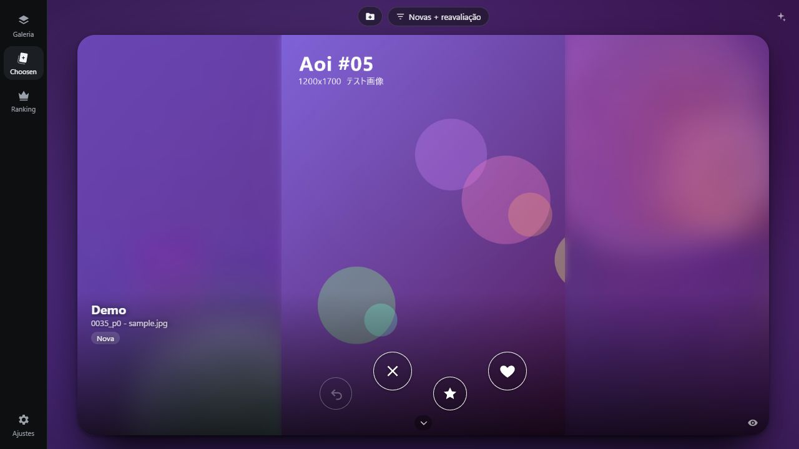
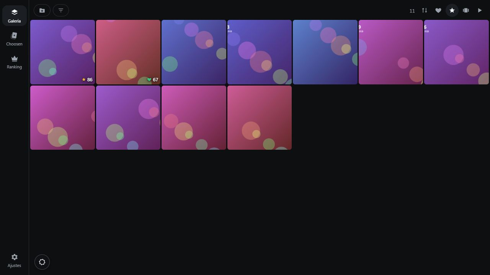
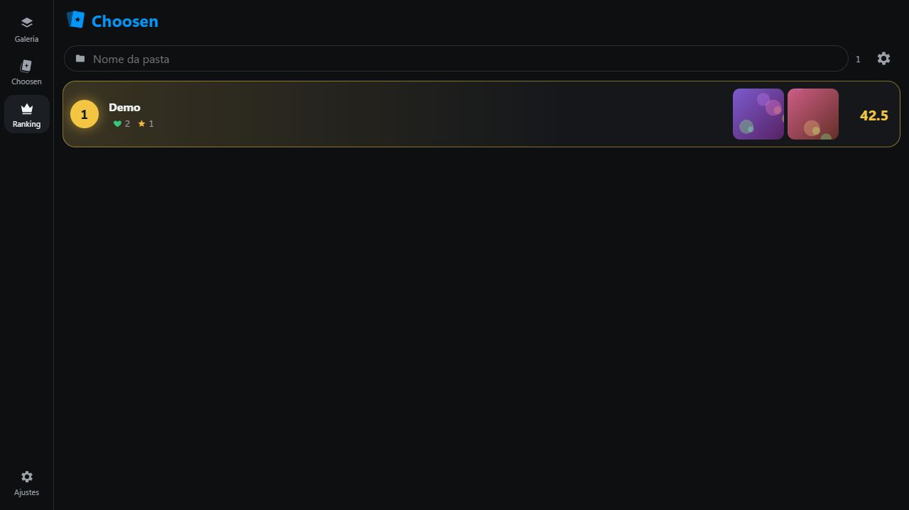
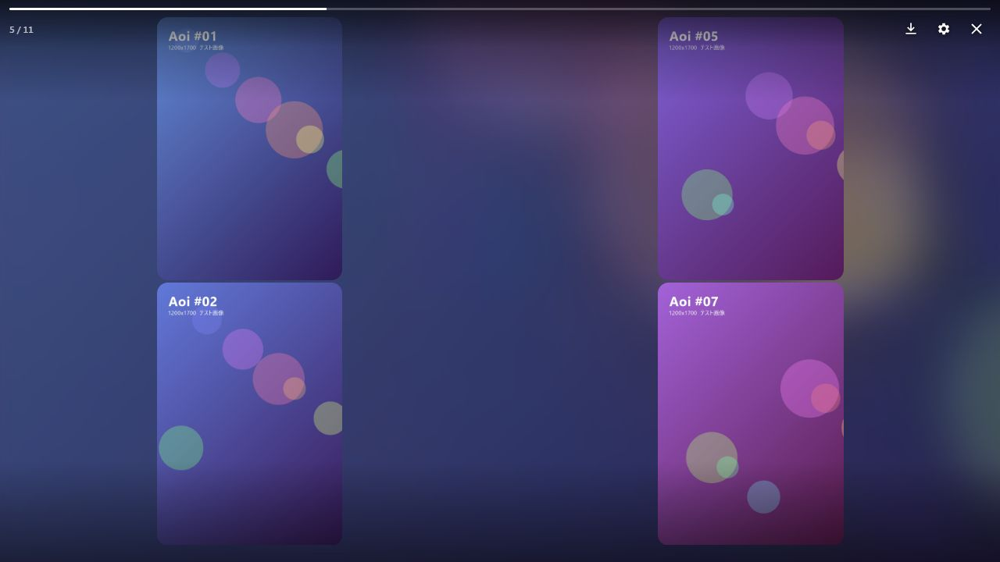

[← Choosen](../README.md) · [日本語](ja.md) · [中文](zh-CN.md) · [English](en.md) · [ไทย](th.md) · [Português](pt-BR.md)

# Choosen 📸

写真をTinderみたいにスワイプ。お気に入りを見つけよう！

[⬇ Android APK](https://github.com/Take-No-Break/Choosen/releases/download/v0.16.0/Choosen-Android-arm64.apk) · [⬇ Windows ZIP](https://github.com/Take-No-Break/Choosen/releases/download/v0.16.0/Choosen-Windows-x64.zip)

⚠️ 0.16.0はまだVirusTotalで検査していません。0.12.0の結果は、Windows版が2/71件の検出（調査中）、Android版が0/68件です。[検査結果](../SECURITY-CHECKS.md)をご確認ください。

## 好き？それともパス？

フォルダを選んだら、写真をスワイプ。♥は好き、★は大好き。ボタンでも気軽に評価できます。

## お気に入りを、ひと目で

写真を一覧で眺めたり、評価で絞り込んだり。気になった1枚を大きく開けます。

## あなたの「好き」がランキングに

写真を評価すると、フォルダのランキングも育っていきます。どのフォルダがお気に入りか、ひと目でわかります。

## 見つけた写真を、ゆっくり楽しむ

プレイで写真を自動表示。複数枚を並べたり、横にめくるスライドで眺めたりできます。

*画面は現在のWindows版を、生成したテスト画像だけで撮影したものです。個人の写真は使用していません。Androidでは画面幅に合わせてレイアウトが変わります。*

写真と評価は端末内に保存されます。アプリ内の言語は日本語・英語・ポルトガル語です。

## 使ってみる

- Android：スマホでAPKをダウンロードして開き、ブラウザーからのインストールを許可します。Android 10以降・ARM64対応。
- Windows：ZIPを展開し、Start-Choosen.cmdを開きます。64ビットWindowsとMicrosoft Edgeが必要です。

気になることやアイデアは [Issues](https://github.com/Take-No-Break/Choosen/issues) へどうぞ！

## 制作・協力

**Bruno Eric / Take-No-Break**：企画・仕様の判断・実機での確認。**Claude Opus（AnthropicのAI）** と **Codex（OpenAIのAI）**：実装・レビュー・開発支援。[役割の詳細](../CONTRIBUTORS.md)。
